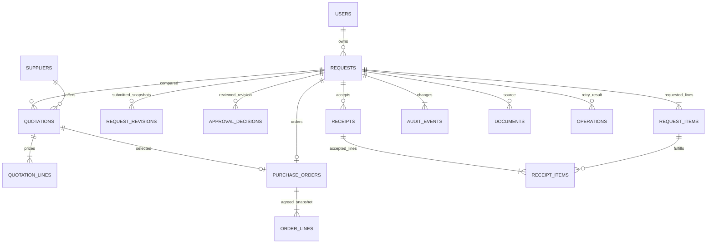

# Procurement v4 scope and requirement mapping

Source brief: `Programming Test v4 (1).pdf`, pages 1 and 3, supplied by the candidate. The earlier chat/mobile clauses are absent from the Procurement section in v4. They are not Procurement requirements.

## Business boundary

The application handles the internal request, approval, quotation selection, purchase order and acceptance of delivered goods/services. It records accepted quantities without maintaining a warehouse inventory ledger. For a service, quantity represents whole accepted deliverables. Payment is excluded.

One organization, four roles, one approval stage, one supplier/PO per request, whole quantities and whole IDR. No tax, discounts, returns, substitutions, split-supplier orders, PO amendments, supplier portal, user administration or real vendor communication. Supplier contacts are reference data; issuing a PO creates a local record and sends no order.

## Permissions and states

| Role | Reads | Writes |
| --- | --- | --- |
| Requester | Own request, order, delivery and source-document details | Create draft; edit draft/returned/approved-but-unordered request; submit; cancel before PO |
| Approver | Organization requests and details | Approve or return the current submitted revision; cannot review own request |
| Purchasing | Organization requests and details | Add suppliers; record quotations/documents; issue PO within current approved budget |
| Receiver | Organization requests and details | Record inspected, accepted delivery quantities for outstanding POs |

The application checks role, ownership, workflow state and expected version separately. Reading a record does not confer permission to mutate it.

| From | Action | To | Guard |
| --- | --- | --- | --- |
| New | Create | Draft | Valid request with 1-20 lines, valid date, positive bounded amounts |
| Draft | Submit | Submitted | Current version; required date not passed; freeze revision snapshot |
| Submitted | Approve | Approved | Approver, no self-approval; decision binds current revision |
| Submitted | Return | Revision needed | Approver; feedback required |
| Draft, returned, approved | Edit | Draft | Owning requester; no PO; revision note; previous approval cleared |
| Draft, submitted, returned, approved | Cancel | Cancelled | Owning requester; no PO |
| Approved | Record quotation | Approved | Purchasing; current approval; existing supplier; reviewed line prices |
| Approved | Issue PO | Ordered | Purchasing; current quotation/revision; total within approved estimate |
| Ordered, partial | Accept delivery | Partial or received | Receiver; unique delivery reference; positive accepted quantity; no over-receipt |

Received and cancelled are terminal. Submitted content cannot be edited while under review; the approver must return it or the owner may cancel. Editing previously submitted content increments the revision. Earlier items, submitted snapshots and quote history remain stored. Changing a draft that was never submitted does not create a fictional submitted revision.

Each quotation stores price and delivery lead time for the approved requested quantities. A selected quotation produces immutable PO lines and supplier details. Quotes above budget can be recorded for comparison but cannot be ordered. An incorrect saved quotation can be superseded by a new referenced quotation; direct edits of issued records are not supported.

## Data model

Prices use integer rupiah. Requested estimates, quoted prices and agreed PO prices are separate. Foreign keys, quantity bounds and unique constraints complement operation validation. `models.py` defines the current schema and Alembic tracks changes. The old `schema.sql` is retained only as a v1 migration-test fixture, not the current initializer.

PostgreSQL uses a request-row lock; SQLite uses an immediate write transaction. Actor locking precedes request locking. Expected versions detect stale forms after lock acquisition. Receipt, quantities, state, operation token and audit either commit together or roll back together. Reads and external extraction calls do not share a write transaction.

## Document input and optional AI

PDF/JPG/PNG content is validated; images are re-encoded. Files are stored under generated names outside static assets and downloads check request access. Limits: 5 MB, 5 PDF pages, 12 megapixels, six uploads per user per 15 minutes.

Local parsing reads explicitly labeled text PDFs. It is not AI/OCR. Optional Google Gemini extraction accepts PDF/image input with strict output validation, a fixed API endpoint, bounded output and timeout. It requires configured API key/model and explicit upload consent for external processing. It has no purchasing tools and cannot approve or issue orders. Schema validity does not establish semantic correctness; the person verifies source evidence, supplier, currency, quantities, units and prices. Manual entry remains available after failure.

Live Gemini input has been verified with a synthetic quotation image and PDF, using source-checked fields from the [synthetic fixtures](samples/README.md). The regression suite uses synthetic data and mocked provider responses. Sample files support repeatable demonstrations. Accuracy across arbitrary documents has not been measured; no confidence or accuracy number is invented.

## Requirement traceability

| Requirement / design decision | BPMN | WBS | Implementation | Verification |
| --- | --- | --- | --- | --- |
| Python web app; SQLite/PostgreSQL | Pages 1-2 | 9.1-9.4 | app factory, db.py, models.py, migrations | Same regression suite on both engines |
| Request to accepted delivery | Page 1 | 3-6 | workflow.py, purchasing.py, receiving.py | complete flow and partial receipt test |
| Analysis and business boundaries | Pages 1-3 | 1.1-1.3 | scope and role/state matrix | consistency review against v4 |
| Revision-aware approval | Page 1; controls page 2 | 3.4, 4.3 | RequestRevision and ApprovalDecision | returned/full edit; old quotation invalidation |
| Quotation and supplier choice | Page 1 purchasing lane | 5.1-5.4 | quotation lines and selection rationale | agreed-price snapshot and budget rejection |
| Delivery safety | Page 1 receiver lane | 6.2-6.4 | order-line acceptance, versions, tokens | two receivers, duplicate retry, rollback |
| AI/model-assisted form input | Page 3 | 11.1-11.5 | documents.py and extraction.py | schema/timeout/consent regressions; live Gemini PNG/PDF and manual fallback |
| Database schema/debugging | Page 2 controls | 9.4, 10.6 | Alembic legacy adoption | legacy constraint and unknown-price regression |
| One repository, PDF, Excel | This package | 1.1, 1.3 | docs artifacts and source | generated/rendered deliverables |

## Operation and known limits

Use HTTPS and a production WSGI server for hosting, an independent secret key, secure cookies, protected demo access and managed identities. Account-based throttling should be complemented by trusted-proxy/IP controls. Production document parsing needs process isolation and malware scanning appropriate to the deployment. This assessment does not claim those operational controls are deployed.

Audit is append-only through application operations, not tamper-proof against direct database access. There is no offline queue or live push synchronization. A committed operation can be reloaded after reconnection. Public hosting, a remote GitHub repository and a demo video have not been published.

Legacy v1 migration preserves totals and accepted quantities. Unknown historical agreed line prices remain null and are displayed as Not recorded. Legacy submitted content is explicitly marked reconstructed; migration does not invent a historical approver decision.
